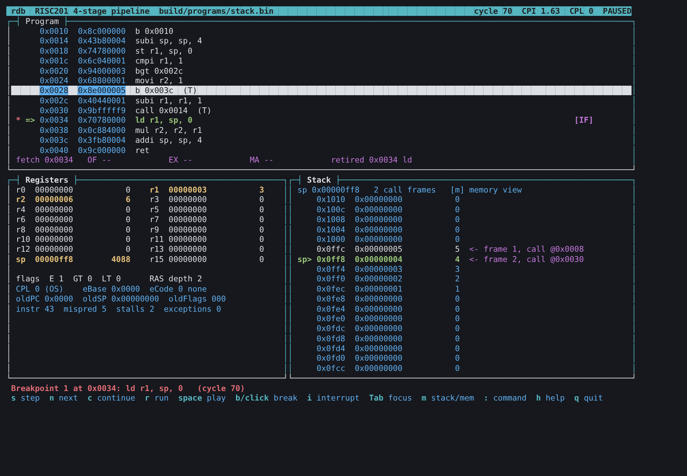
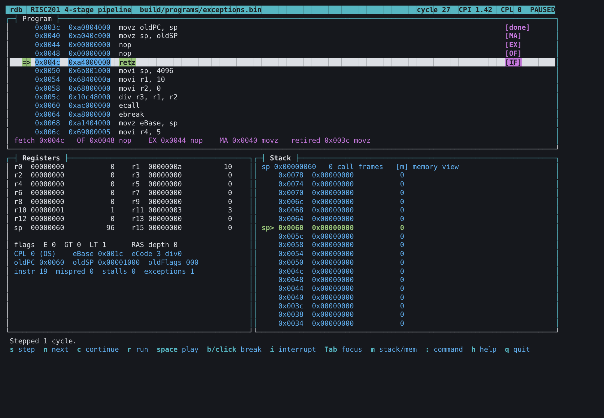

# RISC201 Debugger (rdb)

`rdb` is an interactive debugger for the RISC201 4-stage pipeline simulator
(IF → OF → EX → MA-RW). It is built on the team's precise-exception design
(`exceptions.md`) and comes in two forms: a command line (`--debug`) and a
btop-style full-screen view (`--tui`).



## Quick start

You need a C++17 compiler, `make`, ncurses (preinstalled on macOS; on Ubuntu
`sudo apt install libncurses-dev`) and `python3` for `make test`.

```sh
cd processor_sim
make                    # simulator, microcode ROMs, assembler, test programs
make test               # 18 checks, all should pass
make debug PROG=exceptions   # command-line debugger
make tui PROG=stack          # full-screen debugger
```

To debug your own program, write it in assembly, assemble it with
`./build/assembler my.asm -o my.bin`, end it with `HALT: b HALT`, and run
`./build/processor_sim my.bin --tui`.

## Summary

The RISC201 simulator now runs end to end and has an interactive debugger. All
tests pass: 6 programs in batch mode, the same 6 with a breakpoint on every
instruction, and 6 recorded debugger sessions.

- **Debugger** (`processor_sim/src/debugger/`, `main.cpp`): step by cycle or by
  instruction, run, continue, software breakpoints through `ebreak`, hardware
  breakpoints, `catch` for each exception, watchpoints, and views for registers,
  memory, disassembly, pipeline and the special registers. It can also raise an
  interrupt and edit registers, memory and instructions.

| Folder | What is in it |
|---|---|
| `processor_sim/` | Simulator, debugger, Makefile, microcode source, tests |
| `microassembler/` | New: turns `microcode.masm` into the control-store ROMs |
| `assembler/`, `disassembler/` | Copied unchanged from `sujaan/disassembler` (they match the simulator's encoding) |
| `alu/` | Standalone ALU and its tests (XOR added) |

## How the debugger uses exceptions.md

The debugger is built on the exception mechanism in `exceptions.md`. That document mentions
the debugger directly only once: *pbrk occurs when the OF stage finds an
`ebreak`. Useful for debuggers.*

| exceptions.md | Use in the debugger |
|---|---|
| **Precise exceptions**: a marked instruction drains to MA-RW, older instructions commit, younger ones are flushed | Every stop is at a clean point: the registers show exactly the instructions before the stop |
| **`ebreak` → pbrk** (cause 1) | Software breakpoints: the debugger writes `ebreak` over the instruction and catches its pbrk |
| **Context switch**: `oldPC`, `eCode`, `oldFlags` saved, CPL drops to 0, PC jumps to `eBase` | `catch` stops right after this switch and prints the saved context; `special` shows the registers at any time |
| **Causes**: pbrk 1, scall 2, div0 3, rasovf 4, wronginst 5, lowpriv 6, interrupt 7 | Names for `catch` / `uncatch`, shown in every message |
| **Interrupt**: marks the instruction being fetched | The `interrupt` command raises one from the CLI |
| **`movz` / `retz`, CPL** | Shown by `special`; the test programs use them to install a handler and return to user mode |

The one thing a debugger needs that the document does not have is a way to
**stop instead of jumping to `eBase`**. Without it, a breakpoint would run the
program's own handler. That is the debug trap described next.

## How the debugger works

The debugger drives the CPU one clock cycle at a time with `Cpu::Step()`. After
every cycle it checks five stop conditions, in this order: software breakpoint,
caught exception, watchpoint, hardware breakpoint, and halt or cycle limit.

### Software breakpoints (`break`)

These are the main breakpoints and work like `int3` on x86.

1. **Insert:** save the instruction at the address and write `ebreak` (opcode `0x2A`) in its place.
2. **Hit:** OF marks the `ebreak` as pbrk. It drains to MA-RW like any exception: older instructions commit, younger ones are flushed.
3. **Debug trap:** at MA-RW the CPU asks the debugger's trap function *is this pbrk one of yours?* If yes, there is **no context switch**: no `oldPC`/`eCode` write, CPL unchanged. The PC is set back to the breakpoint address, and the debugger stops.
4. **Show:** the debugger puts the original instruction back, so `disasm` and `pipe` show the real code.
5. **Resume:** on `continue`, the original instruction runs. As soon as it leaves MA-RW, the `ebreak` is written back, so the breakpoint hits again next time.

```
break 0x0c ──► save word, write ebreak ──► OF marks pbrk ──► drains to MA-RW
                                                               │
                                     debugger's ebreak? ◄──────┘
                                      │ yes                │ no
                     stop: PC = 0x0c, no context switch    exceptions.md: jump to eBase
                                      │
                    continue: original runs, ebreak re-inserted when it retires
```

The program's own `ebreak` instructions (not placed by the debugger) still go to
its handler at `eBase`, as `exceptions.md` says. To stop on those, use `catch pbrk`.

One subtle case: the in-memory branch predictor writes `instruction ^ bit25` back
to memory when a branch commits. A copy of a branch fetched before its breakpoint
was inserted could overwrite the `ebreak`. After every cycle the debugger checks
each breakpoint and re-inserts it, keeping the predictor's new word as the original.

### Catching exceptions (`catch`)

`catch div0` (or `scall`, `pbrk`, `rasovf`, `wronginst`, `lowpriv`, `interrupt`,
`all`) stops in the cycle that exception is taken. The context switch has already
happened, so the stop message shows `eCode`, `oldPC`, `oldFlags`, the new CPL and
the handler address. From there you can `step` through the handler and watch
`retz` return to user mode.

### Watchpoints (`watch`)

`watch r5` or `watch mem 0x100` remembers the value. After each cycle, if it
changed, the debugger stops and names the instruction that wrote it (from what
committed at MA-RW that cycle).

### Hardware breakpoints (`hbreak`)

These compare the PC instead of patching memory. They stop in the cycle the
address is fetched into IF/OF. They are useful for code you don't want to
modify, and to show fetch timing.

### Stepping

- `step [n]`: n clock cycles. For n > 1 it prints one line per cycle, then the full pipeline view.
- `next [n]`: runs until n instructions have left the pipeline (committed or raised).
- `continue` / `run`: run until a stop. `run` first reloads the program and resets the CPU. A per-command cycle limit (default 100,000) stops runaway programs.

### What the CPU exposes

Read-only getters on `Cpu` (registers, memory, special registers, the three
pipeline registers, RAS, flags), plus these controlled hooks:

- `SetDebugTrap(fn)`: the debug trap above.
- `LastRetired()`: what left MA-RW this cycle: pc, instruction, register or memory write, or the exception it raised.
- `SetPc()`: redirects fetch.
- `Retired()`: instruction count, used for CPI.

## Command reference

Type `help` inside rdb for the same list. Numbers can be decimal, `0x` hex or `0b` binary.

| Command | What it does |
|---|---|
| `run` / `r` | Reload the program, reset the CPU (CPL 0, cycle 0) and run |
| `continue` / `c` | Run until a breakpoint, watchpoint, caught exception, halt or the cycle limit |
| `step [n]` / `s` | Advance n clock cycles (default 1), then show the pipeline |
| `next [n]` / `n` | Advance until n instructions leave the pipeline |
| `reset` | Reload the program and reset the CPU; breakpoints are kept |
| `interrupt` | Raise a hardware interrupt: the next fetched instruction is marked |
| `break <addr>` / `b` | Software breakpoint (patches `ebreak`, precise stop at MA-RW) |
| `hbreak <addr>` | Hardware breakpoint (stops when the address is fetched) |
| `watch r<n>` / `watch mem <addr>` | Stop when the value changes |
| `catch <exc>...` / `catch all` | Stop when that exception is taken; bare `catch` lists them |
| `uncatch <exc>...` / `uncatch all` | Stop catching |
| `delete [id]` / `enable <id>` / `disable <id>` | Manage breakpoints and watchpoints (`delete` alone removes all) |
| `info break` / `info watch` / `info catch` | List them, with hit counts |
| `regs` | All 16 registers (hex and decimal), next-fetch PC, flags E/GT/LT |
| `print r<n>` / `print mem <addr>` / `print pc` | One value |
| `set r<n> <v>` / `set mem <addr> <v>` / `set inst <addr> <word>` | Change a register, a data word, or an instruction (e.g. plant an invalid opcode) |
| `x <addr> [n]` | n data-memory words (default 4) |
| `mem` | Every data-memory word written so far |
| `disasm [addr] [n]` / `list` | Disassembly; `=>` marks the next fetch, `*` a breakpoint |
| `pipe` | IF/OF, OF/EX, EX/MA contents, the control word in each stage, exception marks, what retired |
| `special` | CPL, eBase, eCode, oldPC, oldSP, oldFlags, pending interrupt |
| `scratch` | Microcode scratch registers s0–s15 |
| `stats` | Cycles, instructions, CPI, mispredictions, stall cycles, exceptions taken |
| `trace on` / `trace off` | One line per cycle while running |
| `help`, `quit` | |

Command-line options:

```
processor_sim <program.bin> [--debug] [--script <file>] [--tui] [--trace]
              [--max-cycles <n>] [--rom <file>] [--table <file>]
```

Without `--debug` or `--tui` it runs the program to halt and prints the final
state (batch mode). `--script` runs debugger commands from a file and echoes
each one, which is how the test sessions and a repeatable demo work.

## Full-screen view (--tui)

`make tui PROG=stack` (or `processor_sim <program.bin> --tui`) opens the same
debugger as a full-screen terminal view, laid out like btop. It needs a terminal
of at least 80x20.



| Panel | Shows |
|---|---|
| **Program** (top) | Every instruction with its address, hex word and disassembly. `*` = breakpoint, `h` = hbreak, `=>` = next fetch. A tag on the right shows which stage each instruction is in (`[IF]`, `[OF]`, `[EX]`, `[MA]`, `[done]`), and the last line is a strip of the whole pipeline. |
| **Registers** (bottom left) | r0–r15 in hex and decimal, with values changed by the last action in yellow. Then flags, RAS depth, CPL, eBase, eCode, oldPC, oldSP, oldFlags and the counters (instructions, mispredictions, stalls, exceptions). |
| **Stack** (bottom right) | A scrollable list of memory words around `sp`, high addresses on top, like btop's process list. The `sp>` row is green, words below sp are dimmed, and each call frame is labelled with the address of the `call` that made it. `m` switches to every data word the program has written. |

| Key or mouse | Action |
|---|---|
| Click an instruction, `b`, Enter | Toggle a breakpoint on it |
| `s`, `S` | Step 1 cycle, 10 cycles |
| `n` | Next instruction |
| `c` | Continue to the next stop |
| `r`, `R` | Restart and run, reset |
| Space, `+`, `-` | Play (auto-step), faster, slower |
| `i` | Raise an interrupt |
| `m` | Stack / memory view |
| Tab, arrows, PgUp/PgDn, mouse wheel | Switch panel and scroll |
| `:` | Type any rdb command, e.g. `:catch all` |
| `h`, `q` | Help, quit |

## Microcode

The team's control unit is microprogrammed. It loads two ROM files:
`microprograms.rom` (38-bit microinstructions) and `rom_address_table.rom`
(start address per opcode). The control unit expected a tool at
`../microassembler` to build them, but none existed, so one was written.

- **`microassembler.cpp`** reads a text file of micro-routines and writes both ROMs. It uses exactly the format `control_unit.cpp` decodes: `opcode[37:32] dst[31:27] src1[26:22] src2[21:17] imm[16:1] stall[0]`, packed as an MSB-first bit stream. It checks that every macro instruction has a routine and sets `stall = 1` on all but the last micro-op of a routine. `-l` prints a listing.
- **`microcode.masm`** holds one micro-op per instruction (`add: madd`, `ld: mld`, `call: mcall`, ...). That is all this pipeline needs: OF supplies the operands and MA-RW the writeback. `nop` comes first because opcodes outside the table start at address 0.
- One micro-op was added, `mnop` (0x3E), with no effect, for `nop`.

Result: 44 microinstructions, 209 bytes. Every instruction executes through the control store.

## Test programs (`processor_sim/tests/programs/`)

`make test` runs each program in batch mode and again with a breakpoint on every
instruction (the results must match), then replays 6 recorded debugger sessions.

| Program | What it exercises | Result (cycles / instructions) |
|---|---|---|
| `breakpoints` | Loop summing 1..10, store and load back, a load-use stall | r3 = 55, mem[256] = 55 (63 / 55) |
| `calls` | `call`/`ret` through the RAS; `mul`, `mod`, `xor`, `not` | r3 = 42, r7 = 43 (20 / 11) |
| `exceptions` | Boot code installs a handler and drops to user mode with `retz`. The user code raises div0, scall, pbrk and lowpriv; the handler counts each and skips it | r10 = 4 exceptions, r11 = 6 (88 / 64) |
| `interrupt` | Counting loop for the `interrupt` command; the handler returns to the marked instruction, so the count still ends at 200 | r1 = 200 (817 / 809) |
| `rasovf` | 17 nested calls overflow the 16-entry return-address stack | r1 = 17, r10 = 1, r11 = 4 (66 / 55) |
| `stack` | Recursive factorial of 5 with a stack frame per call, for the TUI's stack panel | r2 = 120, mem[256] = 120 (74 / 52) |

Each program's `# expect:` line lists its final values. The exception programs
share one handler: it saves `sp` in `oldSP`, reads `eCode`, counts in r10, keeps
the cause in r11, and skips the faulting instruction unless it was an interrupt.