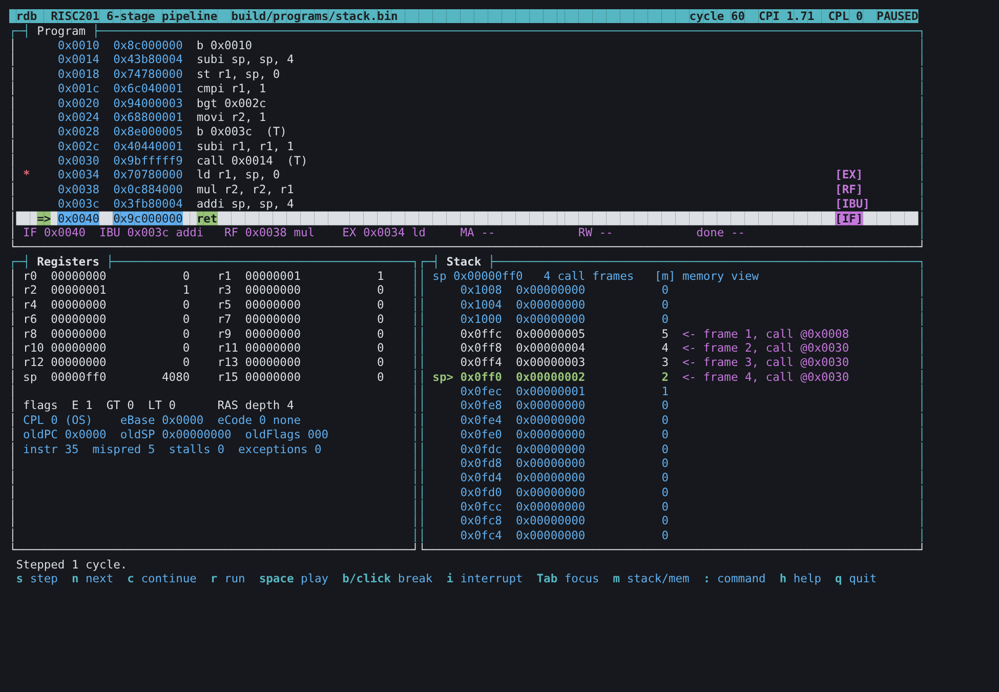

# processor_sim6 — RISC201 6-stage pipeline simulator and debugger

A cycle-accurate simulator of the 6-stage datapath in
[`../6StagePipeline.svg`](../6StagePipeline.svg), with the same debugger (`rdb`)
and btop-style full-screen view as the 4-stage `processor_sim4/`. It uses the
team's components unchanged (ALU, microcoded Control Unit, Register File, RAS,
Scratch File, memory) and the same microcode, assembler and test programs.



## Quick start

```sh
cd processor_sim6
make                         # simulator, microcode ROMs, assembler, test programs
make test                    # 21 checks, all should pass
make debug PROG=hazards      # command-line debugger
make tui PROG=stack          # full-screen debugger
./build/processor_sim6 build/programs/hazards.bin --trace   # one line per cycle
```

Requirements and every debugger command and key are the same as in
`../processor_sim4/` (see its README and DEBUGGER_README).

## The six stages

```
 IF ──IF/IBU──► IBU ──IBU/RF──► RF ──RF/EX──► EX ──EX/MA──► MA ──MA/RW──► RW
```

| Stage | File | What it does (from 6StagePipeline.svg) |
|---|---|---|
| **IF** | `stage_if` | PC, instruction memory, prediction from `Inst[25]`, branch target `PC + (offset << 2)`, main PC mux (exception, CorrectPC, retz, RAS Out, NextPC) |
| **IBU** | `stage_ibu` | Instruction / Branch Unit: decode, Immediate Unit, Control Unit (microcode), RAS push on `call` / pop on `ret`, exception marking (wronginst, lowpriv, pbrk, scall, rasovf) |
| **RF** | `stage_rf` | Register File read; the `isSt` mux selects rd as the second read register for a store; `movz` reads its window source |
| **EX** | `stage_ex` | Forwarding Unit, AluSrcA / AluSrcB muxes, ALU and flags, Scratch File, Correct PC Recovery Unit, div0 marking |
| **MA** | `stage_ma` | Memory Unit (`mar` = AluResult, `mdr` = op2), predictor inversion `Inst ^ (1 << 25)` |
| **RW** | `stage_rw` | Writeback mux (LdResult if `isLd`, else AluResult) into GPR[rd]; the commit point where exceptions are taken |

Pipeline registers are in `include/common/pipeline_registers.hpp`; the cycle is
in `Cpu::Step()` (`src/core/cpu.cpp`), which evaluates RW, MA, EX, RF, IBU, IF
in that order so each stage reads its input register before it latches.

## Hazard handling

| Unit | Rule |
|---|---|
| **Forwarding Unit** | EX takes an operand from the instruction in MA (ALU result) or in RW (any result). RW writes the Register File before RF reads it, so nothing older needs forwarding. |
| **Data Lock Unit: load-use** | A load in EX whose register the instruction in RF reads: IF, IBU and RF hold for one cycle and a bubble goes into EX. The value is then forwarded from RW. |
| **Data Lock Unit: special registers** | `retz` waits in IBU until RF, EX and MA are empty; `movz` waits while an older `movz` is in RF, EX or MA. They read oldPC / eBase early and `movz` writes them in RW, so this makes handler code safe without `nop` padding. |
| **Branch Lock Unit** | A misprediction is found in EX, so three wrong-path instructions (in RF, IBU and IF) are flushed. |
| **RAS repair** | The RAS is updated in IBU, three stages before a branch resolves. Every packet carries the RAS as it was before and after its IBU step; a misprediction restores the branch's "after" copy and an exception restores the faulting instruction's "before" copy, so wrong-path `call`/`ret` leave no trace. `tests/programs/hazards.asm` fails (r1 = 107 instead of 7) without this. |
| **Precise exceptions** | Marked in IF / IBU / EX, taken in RW. While a marked instruction is in MA or RW, EX does not run, and while it is in RW, MA does not run, so younger instructions never change flags, the Scratch File or memory. |
| **Halt** | The branch-to-self is detected in EX but the program stops when it reaches RW, so the instructions ahead of it (in MA and RW) still commit. |

## 4-stage vs 6-stage on the test programs

| Program | 4-stage cycles | 6-stage cycles | 6-stage stalls | Why |
|---|---|---|---|---|
| `breakpoints` | 63 | 68 | 1 | 2 more fill cycles, misprediction costs 3 instead of 2 |
| `calls` | 20 | 25 | 0 | longer fill and drain |
| `exceptions` | 88 | 148 | 49 | `retz` / `movz` interlocks in the handler, longer exception flush |
| `interrupt` | 817 | 827 | 5 | one interrupt, handler interlocks |
| `rasovf` | 66 | 88 | 16 | handler interlocks |
| `stack` | 74 | 82 | 4 | 4 load-use stalls (`ld r1` then `mul`) |
| `hazards` | — | 41 | 1 | 6-stage-only test |

Instruction counts are one higher than in the 4-stage simulator because the
final branch-to-self now retires.

## Debugger differences

- The pipeline view (`pipe`, `step`) shows five registers: IF/IBU, IBU/RF, RF/EX, EX/MA, MA/RW.
- The TUI tags each instruction `[IF] [IBU] [RF] [EX] [MA] [RW]`, and its pipeline strip shows all six stages.
- Software breakpoints stop precisely at RW (the commit point); `catch` stops after the context switch in RW.
- A memory watchpoint names the store that wrote it in MA (one cycle before it retires).

## Tests

`make test`: 7 programs in batch mode against their `# expect:` line, the same 7
with a breakpoint on every instruction (the final state must not change), and 7
recorded debugger sessions (`tests/scripts/`, including `7_six_stage_hazards.rdb`,
which shows a mispredicted branch flushing a wrong-path `ret`, the RAS being
restored, and a load-use stall).

## Known limitations

- `retz` returns in IBU; older instructions are drained first, so it is never on a wrong path.
- Multi-micro-op routines hold IF while the Control Unit sequences, but every routine in `microcode.masm` is one micro-op, so this is untested.
- `hbreak` fires on any fetch, including wrong-path fetches.
